<table>
<tr>
<td width="480" valign="top">

</td>
<td valign="top">

## À propos

### Salut.

Je suis un **dev camerounais autodidacte** de 19 ans.

J'aime **Spider-Man**, la liberté et la bonne bouffe. 🍜

Je passe pas mal de temps à **explorer Linux**, bidouiller des configs et donner vie à des idées. Je touche à plusieurs technos et je construis des projets à ma façon.

Mon objectif ? Aucun, dans la vie j'ai pas vraiment de but. Je pense juste qu'on doit apprécier la vue avant de scier la branche.

**Pour me contacter**

- Discord : [Mon profil](https://discordapp.com/users/1477032203064967229)
- Twitter : [@kelianfb](https://twitter.com/kelianfb)
- Element : `@kamey.4:matrix.org`

</td>
</tr>
</table>

## Ce que j'ai fait

<table>
<tr>
<td width="33%" valign="top">

### [cera](https://github.com/kelian-4/cera)

Éditeur de texte en terminal, écrit en Rust avec un system de plugins.

`Rust`

</td>
<td width="33%" valign="top">

### [bridge](https://github.com/kelian-4/bridge)

Relie WhatsApp et Signal via mautrix. Synapse et les passerelles tournent en Docker,Nix et une version termux avec des scripts Python pour automatiser.

`Python` · `Docker` · `Nix`

</td>
<td width="33%" valign="top">

### [gamepad](https://github.com/kelian-4/gamepad)

Transforme ton iPhone en manette de jeu pour ton PC Linux.

`Swift` · `Python`

</td>
</tr>
</table>

Pièces d'échecs : cburnett (Lichess), licence GPLv2+/BSD/GFDL.
